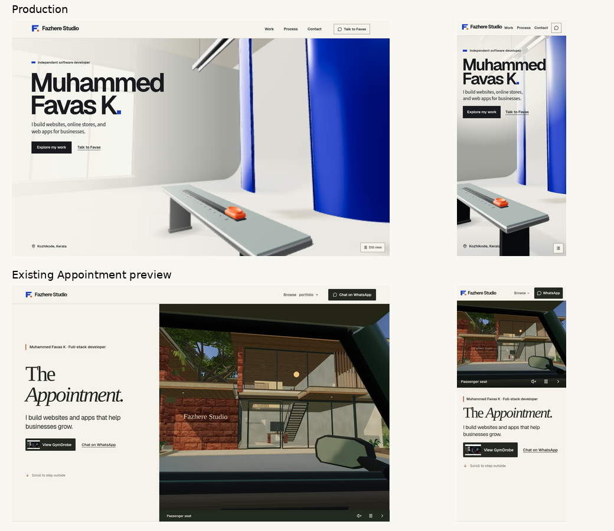
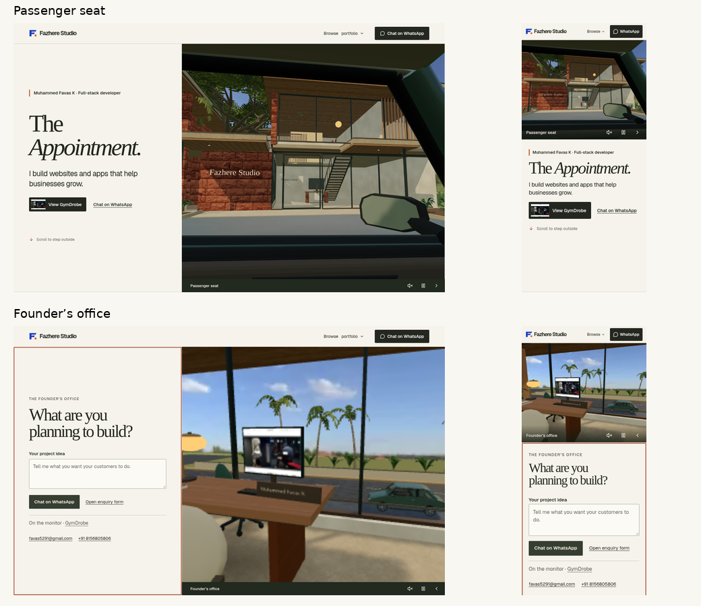

# Hosted baselines, 27 November 2026

The production homepage opens on Muhammed Favas K, his business offer and “Talk to Favas,” which links to WhatsApp. The first view at either size leaves GymDrobe below the fold. In the Appointment preview, the founder's name and role, the business offer, “View GymDrobe,” “Chat on WhatsApp” and “Scroll to step outside” fit the first phone screen. The thumbnail on its project button loads the hashed GymDrobe WebP.

The earlier Appointment already includes a kerbside car in the office still. On the wide view the car's front reaches the frame edge. On both sizes the office monitor covers much of the glass, and the screen and desk plate look soft. From the passenger seat the car mirror, door frame and roof rail read as angular silhouettes, and the outside pavement lacks a clear wet reflection. There is no open timber panel that can be matched confidently between the pictures. The next visual trial should retain the car, make its wheels and profile easy to recognize, and place the same open panel in both bookends.

| Mode | Desktop | Emulated phone |
|---|---|---|
| [Production](https://fazhere.com/) | [1440 × 900](production-1440.png) | [390 × 844](production-390.png) |
| [Existing Appointment preview](https://fazhere-appointment-preview.onrender.com/) | [1440 × 900](appointment-1440.png) | [390 × 844](appointment-390.png) |
| [Existing office](https://fazhere-appointment-preview.onrender.com/#office) | [1440 × 900](appointment-office-1440.png) | [390 × 844](appointment-office-390.png) |

The four homepage captures came from fresh Playwright contexts with HTTP 200 responses, zero scroll, document load and fonts complete, followed by a five-second hold. Chromium 156.0.8078.79 ran headlessly on Linux with software rendering via SwiftShader. The phone used a touch-enabled Android/Chrome user agent. Both sizes used DPR 1, normal motion preference and ordinary network speed. A second observation found the production Three.js r186 canvas visible at both sizes. The Appointment displayed arrival-wide.webp or arrival-compact.webp with the canvas hidden. Office images use direct hash entry and the corresponding office still. These captures document existing hosted visuals. They provide no human acceptance or physical-device performance data.

The four sibling JSON records preserve response status, viewport, hashed bundles, first-page text, link targets, canvas buffer size, and uncaught page errors from the capture. The link list uses geometry and can include hidden menu items.
